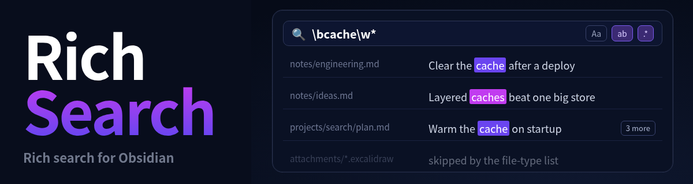
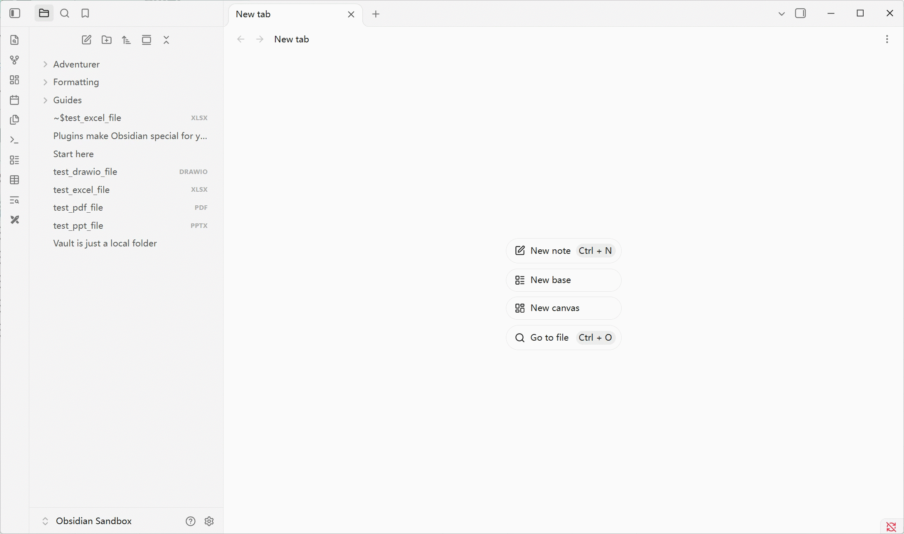

<div align="center">



<p>
  <b>🔤 Whole word &nbsp;·&nbsp; 🧮 Regex &nbsp;·&nbsp; 📁 Search by folder &nbsp;·&nbsp; 🗂️ Search by file type &nbsp;·&nbsp; 🧩 Cross-format search &nbsp;·&nbsp; 🖍️ Highlight on open</b>
</p>

<p>
  <a href="https://github.com/SdKay/obsidian-rich-search/releases/latest">
    
  </a>
  <a href="https://github.com/SdKay/obsidian-rich-search/releases">
    
  </a>
  <a href="LICENSE">
    
  </a>
  <a href="https://obsidian.md/plugins?id=rich-search">
    
  </a>
  <a href="https://paypal.me/ssdking">
    
  </a>
</p>

<p>
  <a href="#features">Features</a> ·
  <a href="#cross-format-search">Cross-format</a> ·
  <a href="#installation">Install</a> ·
  <a href="#settings">Settings</a> ·
  <a href="#development">Development</a> ·
  <a href="README_CN.md">中文</a>
</p>

<p>
  
  <br/><sub>Follow on WeChat for more Obsidian plugins &amp; tools</sub>
</p>

<table>
  <thead>
    <tr><th colspan="3">Other plugins I build</th></tr>
    <tr><th>Plugin</th><th>Description</th><th>Install page</th></tr>
  </thead>
  <tbody>
    <tr>
      <td><a href="https://github.com/SdKay/obsidian-rich-table"><b>Rich Table</b></a></td>
      <td>Spreadsheet-like tables in notes, and a viewer for Excel files; their content is searchable from Rich Search</td>
      <td><a href="obsidian://show-plugin?id=rich-table">Open in Obsidian</a></td>
    </tr>
    <tr>
      <td><a href="https://github.com/SdKay/obsidian-rich-view"><b>Rich View</b></a></td>
      <td>Show draw.io, Visio and PowerPoint right in your notes; their text is searchable from Rich Search</td>
      <td><a href="obsidian://show-plugin?id=rich-view">Open in Obsidian</a></td>
    </tr>
  </tbody>
</table>

</div>

A powerful cross-file search tool for Obsidian. It matches whole words and regular expressions, limits the search to the folders and file types you choose, and searches the text inside PDF, Excalidraw, Excel, PowerPoint, draw.io and Visio files as well as Markdown files. Results are listed grouped by file; click one, or step through them with the arrow keys, to jump to the match, which is marked in the original.



---

## Features

### Search

- **Sidebar panel**: the ribbon icon or *Open search*. The box stays fixed; only the results scroll.
- **Whole word** (works in Chinese, Japanese and Korean), **regular expressions**, **case sensitive**.
- **Search as you type**; Enter searches at once.
- **Scope**: include and exclude folders, and tick file types. Files outside the scope are never read.
- **History**: ↑ / ↓ in the box, or the history button. Restores the text, options and scope.
- **Search in a folder**: right-click a folder in the file explorer.
- **Search from a note**: right-click in a note. Selected text becomes the query.

### Results

- **Grouped by file**, shown as they are found, notes first. The first 2,000 are shown, with more on request.
- **Open a result** with its line centred. Ctrl/Cmd+click opens a new tab.
- **Keyboard**: ↑ / ↓ move through the results; the focus stays in the list.

### Replace

- **Replace** with the arrow left of the box. Matches show as the old text struck out and the new text beside it.
- **One result**, or **Replace all** after a confirmation that says how many notes and lines change.
- **Regular expressions** can use `$1` and `$&` in the replacement.
- **Markdown notes only**. A line changed since the search is skipped, not guessed at.

### Highlighting

- **Matches stay highlighted** in open notes while the panel is open, as in VS Code.
- **The opened match** is brighter, with an outline.
- **Editor, reading view and Markdown tables** are all marked.
- **Only files in the scope** are marked.
- **Diagrams**: the text in mermaid and in SVG PlantUML is marked too.
- **Highlight colour** is set in the settings.

### Other formats

- **PDF**: searched by page text; a result opens at its page.
- **Excalidraw**: searched by the words in the drawing; a result zooms to the element.
- **Excel, PowerPoint, draw.io, Visio**: through Rich Table and Rich View (see [below](#cross-format-search)).

---

## Cross-format search

Notes are not the only place your text lives. Rich Search reads the text a person would actually see in other files and lists it next to your notes. It does not read raw bytes, and it does not carry its own parsers: for formats Obsidian cannot show, it asks the plugin that already renders them.

| Format | Needs | What is searched | State |
|---|---|---|:---:|
| PDF (`.pdf`) | Obsidian's built-in PDF viewer | The text of each page | 🟢 |
| Excalidraw (`.excalidraw`) | [Excalidraw](https://github.com/zsviczian/obsidian-excalidraw-plugin) | The words in the drawing, not the compressed drawing data | 🟢 |
| Rich Table tables | [Rich Table](https://github.com/SdKay/obsidian-rich-table) | What the table shows, not its source | 🟢 |
| Excel (`.xlsx`) | [Rich Table](https://github.com/SdKay/obsidian-rich-table) | Cell values, per sheet. A result opens at its sheet and cell. | 🟢 |
| PowerPoint (`.pptx`) | [Rich View](https://github.com/SdKay/obsidian-rich-view) | Slide text. A result opens at its slide. | 🟢 |
| draw.io, Visio (`.vsdx`) | [Rich View](https://github.com/SdKay/obsidian-rich-view) | Shape and label text. A result opens at its page and shape. | 🟢 |

---

## Installation

**Community plugin browser (recommended):**

1. Open **Settings → Community plugins → Browse**
2. Search for **Rich Search** and install
3. Enable the plugin

**Manual:** copy `main.js`, `manifest.json`, `styles.css` to `<vault>/.obsidian/plugins/rich-search/`

Minimum Obsidian version: **1.8.7**. Works on desktop and mobile.

---

## Settings

In the settings tab:

| Setting | What it does |
|---|---|
| Treat .excalidraw.md as Excalidraw drawings | On: a drawing is its own file type, searched by the words in it. Off: it is an ordinary note. |
| Always exclude folders | One folder per line. They are left out of every search, in addition to the folders excluded in the search panel, and searching in a folder does not bring them back. |
| Open results in | Where a result opens when the search panel is in its own window. *Main window*: the note opens there. *The window of the panel*: it opens to the left of the panel, and later results reuse that tab. Ctrl/Cmd+click always opens a new tab. |
| Match highlight colour | The background of matched words, in the results, in opened notes, in PDFs, in tables and in the Rich Table and Rich View views. Neon yellow-green by default. The match you opened uses this colour; the others use a lighter tint of it. |

In the search panel's **Scope** section:

| Control | What it does |
|---|---|
| Include folders | Search only inside these. Empty means every folder. |
| Exclude folders | Never search these. Subtracted from the included folders. |
| File types | Tick the types to search. |

---

## Limitations

- A scanned PDF with no text layer cannot be searched.
- A PlantUML diagram drawn as PNG has no text to highlight.
- Matches inside a diagram are all drawn the same; the opened one is not brighter.
- Replacing cannot be undone from the panel. A note open in an editor can be undone with Ctrl+Z.

---

## Development

```bash
npm install
npm run dev          # watch
npm test             # unit tests
npm run test:e2e     # browser tests (first run: npx playwright install chromium)
npm run verify:ci    # clean install, build, changelog check, tests
```

---

## License

[AGPL-3.0](LICENSE): derivatives must be open-sourced under the same license.

For **commercial licensing**: sdkxyx@gmail.com

---

## Support the Project

Rich Search is free and open-source under the AGPL-3.0 license. If this plugin has improved your workflow, you can support its ongoing development with a voluntary donation. Every contribution helps fix bugs and add new features.

### 💳 PayPal
[](https://paypal.me/ssdking)

### 🧧 WeChat Pay / Alipay

| WeChat Pay | Alipay |
|:---:|:---:|
|  |  |

Thank you for your support! 🙏

---

## Feedback

Issues and feature requests: [GitHub Issues](https://github.com/SdKay/obsidian-rich-search/issues)

---

[](https://star-history.com/#SdKay/obsidian-rich-search&Date)
