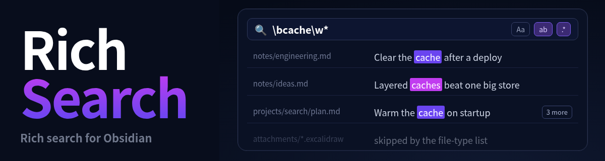

<div align="center">



<p>
  <b>🔤 全词匹配 &nbsp;·&nbsp; 🧮 正则表达式 &nbsp;·&nbsp; 📁 按目录查找 &nbsp;·&nbsp; 🗂️ 按文件类型查找 &nbsp;·&nbsp; 🧩 跨类型搜索 &nbsp;·&nbsp; 🖍️ 全局高亮</b>
</p>

<p>
  <a href="https://github.com/SdKay/obsidian-rich-search/releases/latest">
    
  </a>
  <a href="https://github.com/SdKay/obsidian-rich-search/releases">
    
  </a>
  <a href="LICENSE">
    
  </a>
  <a href="https://obsidian.md/plugins?id=rich-search">
    
  </a>
  <a href="https://paypal.me/ssdking">
    
  </a>
</p>

<p>
  <a href="#功能">功能</a> ·
  <a href="#演示">演示</a> ·
  <a href="#跨类型搜索">跨类型搜索</a> ·
  <a href="#安装">安装</a> ·
  <a href="#设置">设置</a> ·
  <a href="#开发">开发</a> ·
  <a href="README.md">English</a>
</p>

<p>
  
  <br/><sub>扫码关注公众号，获取更多 Obsidian 插件与效率工具资讯</sub>
</p>

<table>
  <thead>
    <tr><th colspan="3">我开发的其他插件</th></tr>
    <tr><th>插件</th><th>简介</th><th>Obsidian 安装页</th></tr>
  </thead>
  <tbody>
    <tr>
      <td><a href="https://github.com/SdKay/obsidian-rich-table"><b>Rich Table</b></a></td>
      <td>在笔记里写类电子表格的表格，并可查看 Excel 文件；它们的内容可在 Rich Search 里搜索</td>
      <td><a href="obsidian://show-plugin?id=rich-table">在 Obsidian 中打开</a></td>
    </tr>
    <tr>
      <td><a href="https://github.com/SdKay/obsidian-rich-view"><b>Rich View</b></a></td>
      <td>在笔记中直接显示 draw.io、Visio、PowerPoint；其中的文字可在 Rich Search 里搜索</td>
      <td><a href="obsidian://show-plugin?id=rich-view">在 Obsidian 中打开</a></td>
    </tr>
  </tbody>
</table>

</div>

强大的 Obsidian 跨文件搜索工具。支持全词匹配与正则表达式，可按目录和文件类型限定搜索范围；除Markdown文件外，还可搜索 PDF、Excalidraw、Excel、PowerPoint、draw.io 和 Visio 文件中的文字。结果按文件分组列出，点击或用方向键即可跳转到命中位置，并在原文中逐一标出。

---

## 功能

- **侧边栏搜索面板**（左侧工具栏图标，或命令“打开搜索”）：可拖到任意一侧。查询框和选项固定在顶部，只有结果区滚动。
- **全词匹配**，对中文、日文、韩文同样有效
- **正则表达式**；输入到一半时只提示原因，不会报错中断
- **区分大小写**开关
- **边输入边搜索**，按回车立即搜索；新的查询会取消仍在进行的上一次搜索
- **搜索范围**：包含目录与排除目录（排除目录若在包含目录之内，则从中扣除），并勾选要搜索的文件类型。被跳过的文件根本不会被读取。
- **打开结果**到主编辑区（Ctrl/Cmd+点击在新标签页打开）。笔记打开后，命中的那一行会在窗口中间，阅读视图和编辑视图都一样。
- **用键盘在结果间移动**：↑ / ↓ 选中上一条或下一条并打开它，焦点留在结果列表里。选中的结果带有背景色，和 VS Code 一样。
- **命中的词持续高亮**：和 VS Code 一样，只要搜索面板开着且查询不为空，所有打开的笔记里的命中词都保持高亮；在笔记里点击、输入、按 Esc 都不会清除。你点开的那一个画得更亮并带外框，其余的较暗。编辑视图、阅读视图和 Markdown 表格里都是如此。只标出搜索范围内的笔记：不在搜索的目录和文件类型之内的笔记不会被标出，修改范围后标记随之变化。
- **自定义高亮颜色**：在设置里选，所有显示命中词的视图都使用它。
- **搜索历史**：在查询框按 ↑ / ↓ 在之前的搜索间来回切换，每次都会恢复关键字、三个选项和搜索范围。框里的按钮会列出这些搜索，最新的在上：点一条恢复它，点它后面的 × 只忘掉这一条，或选择“清空历史”。
- **在目录中搜索**：在文件目录树里右键某个目录，选择“在此目录搜索”。包含目录会变成这个目录，排除目录清空，框里已有的查询会用新范围重新搜索。
- **Excalidraw 绘图**按其中的文字搜索，点击结果会打开绘图并缩放到对应元素（需要 Excalidraw 插件）。
- **PDF 文件**按每一页的文字搜索。点击结果会在 Obsidian 的查看器里打开到那一页，滚动到的页面上的命中词也会被标出。没有文字层的扫描版 PDF 搜不了，会计入“无法读取”的文件。大 PDF 第一次搜索要等一会儿，之后文字会保存在内存里。
- **Excel、PowerPoint、draw.io、Visio 文件**通过 Rich Table 和 Rich View 插件搜索，点击结果会打开文件并定位到工作表和单元格、幻灯片或图形（见[下文](#跨类型搜索)）。
- **结果很多时**：只显示前 2000 条，上方显示真实总数，并提供按钮继续显示更多。结果边找边出现，笔记先出。

---

## 演示

<!-- 添加演示：将 GIF 按下方各注释中的文件名保存到 docs/，删除“即将推出”一行以及图片行两侧的注释标记。 -->

### 全词、正则与搜索范围

输入关键字，打开全词或正则，并把搜索限定在某些目录和文件类型里。结果边找边出现。

> 🎬 *演示 GIF 即将推出*
<!--  -->

### 打开一条结果

面板开着时，打开的笔记里所有命中词都保持高亮；你点开的那一个更亮并带外框，所在行居中，↑ / ↓ 在结果间移动。

> 🎬 *演示 GIF 即将推出*
<!--  -->

### PDF 与 Excalidraw

搜索 PDF 每一页的文字和 Excalidraw 绘图里的文字。PDF 会打开到对应的页并标出命中词；绘图会缩放到对应元素。

> 🎬 *演示 GIF 即将推出*
<!--  -->

### Excel、PowerPoint、draw.io 与 Visio

装了 Rich Table 和 Rich View 之后，它们的内容会和笔记一起被搜索。点击结果会打开到对应的工作表和单元格、幻灯片或图形。

> 🎬 *演示 GIF 即将推出*
<!--  -->

### 历史记录与在目录中搜索

打开历史列表，选择、删除或清空之前的搜索；在文件目录树里右键某个目录，只在其中搜索。

> 🎬 *演示 GIF 即将推出*
<!--  -->

---

## 跨类型搜索

文字不只存在于笔记里。Rich Search 会读出其他文件里人真正看得到的文字，并和笔记一起列出。它不读原始字节，也不自带解析器：对 Obsidian 本身显示不了的格式，它向已经负责渲染该格式的插件要文字。

| 格式 | 依赖 | 搜索的内容 | 状态 |
|---|---|---|:---:|
| PDF（`.pdf`） | Obsidian 自带 PDF 查看器 | 每一页的文字 | 🟢 |
| Excalidraw（`.excalidraw`） | [Excalidraw](https://github.com/zsviczian/obsidian-excalidraw-plugin) | 绘图里的文字，而不是压缩后的绘图数据 | 🟢 |
| Rich Table 表格 | [Rich Table](https://github.com/SdKay/obsidian-rich-table) | 表格显示出来的内容，而不是它的源码 | 🟢 |
| Excel（`.xlsx`） | [Rich Table](https://github.com/SdKay/obsidian-rich-table) | 各工作表的单元格内容。点击结果会打开到对应的工作表和单元格。 | 🟢 |
| PowerPoint（`.pptx`） | [Rich View](https://github.com/SdKay/obsidian-rich-view) | 幻灯片文字。点击结果会打开到对应的幻灯片。 | 🟢 |
| draw.io、Visio（`.vsdx`） | [Rich View](https://github.com/SdKay/obsidian-rich-view) | 图形与标签文字。点击结果会打开到对应的页和图形。 | 🟢 |

---

## 安装

**推荐 — 社区插件浏览器：**

1. 打开 **设置 → 第三方插件 → 浏览**
2. 搜索 **Rich Search** 并安装
3. 启用插件

**手动安装：** 将 `main.js`、`manifest.json`、`styles.css` 复制到 `<vault>/.obsidian/plugins/rich-search/`

最低 Obsidian 版本：**1.8.7**。支持桌面端和移动端。

---

## 设置

设置页：

| 设置项 | 作用 |
|---|---|
| 将 .excalidraw.md 视为 Excalidraw 绘图 | 开启：绘图是独立的文件类型，按其中的文字搜索。关闭：当作普通笔记。 |
| 始终排除的目录 | 每行一个目录。每次搜索都会排除它们，和搜索面板里设置的排除目录叠加，“在此目录搜索”也不会把它们找回来。 |
| 结果的打开位置 | 搜索面板在独立窗口里时，结果在哪里打开。*主窗口*：笔记在主窗口打开。*面板所在的窗口*：笔记在面板左边打开，之后的结果复用这个标签页。Ctrl/Cmd+点击始终在新标签页打开。 |
| 匹配高亮颜色 | 命中词在结果列表、打开的笔记、PDF、表格和 Rich Table / Rich View 视图里的底色，默认荧光黄绿。点开的那一个用这个颜色，其余的用同一颜色的淡色。 |

搜索面板的**范围**区：

| 控件 | 作用 |
|---|---|
| 包含目录 | 只在这些目录内搜索，留空表示所有目录。 |
| 排除目录 | 始终不搜索，会从包含目录中扣除。 |
| 文件类型 | 勾选要搜索的类型。 |

---

## 开发

```bash
npm install
npm run dev          # 监听构建
npm test             # 单元测试
npm run test:e2e     # 浏览器测试（首次运行：npx playwright install chromium）
npm run verify:ci    # 干净安装、构建、changelog 校验、测试
```

---

## 许可证

[AGPL-3.0](LICENSE)——衍生作品须以相同协议开源。

**商业授权**请联系：sdkxyx@gmail.com

---

## 赞助支持

Rich Search 基于 AGPL-3.0 协议免费开源。如果这个插件让你的工作流更顺手，欢迎自愿赞助，帮助我持续修复问题、增加功能。

### 🌍 PayPal
[](https://paypal.me/ssdking)

### 🧧 微信 / 支付宝

| 微信 | 支付宝 |
|:---:|:---:|
|  |  |

感谢你的支持！🙏

---

## 支持与反馈

问题与功能建议：[GitHub Issues](https://github.com/SdKay/obsidian-rich-search/issues)

---

[](https://star-history.com/#SdKay/obsidian-rich-search&Date)
